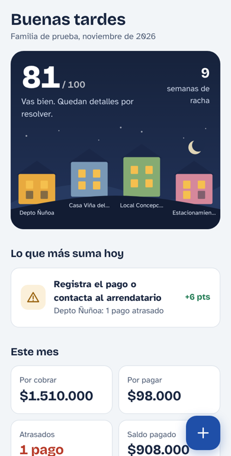
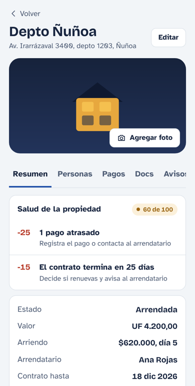
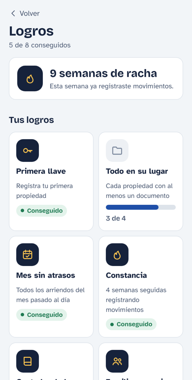
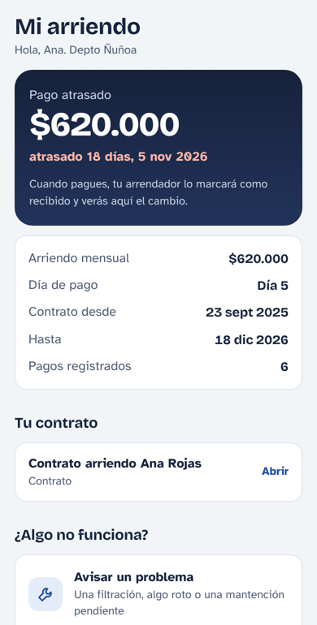

# Casa Clara

App para que una familia administre sus propiedades, arriendos, gastos y documentos desde el teléfono. Se instala en Android y iPhone desde el navegador, funciona sin conexión y se publica gratis en GitHub Pages.

<p>
  
  
  
  
</p>

## Qué hace

- **Barrio iluminado:** cada propiedad es una casa en un cerro. Sus ventanas encendidas (0 a 4) muestran su salud: pagos al día, contrato vigente, documentos completos y propiedad ocupada.
- **Modo juego familiar:** puntaje del hogar, racha semanal por registrar movimientos, 8 logros, desafío del mes y la acción que más puntos suma hoy. Todo se calcula con datos reales; cada punto perdido explica por qué y cómo recuperarlo.
- **Finanzas:** ingresos, gastos, arriendos, gastos comunes y cuentas, en CLP, UF o USD. Foto de la boleta adjunta. Los arriendos de cada mes se crean solos.
- **Propiedades y personas:** fichas con foto, contrato, personas asociadas, movimientos, documentos y solicitudes.
- **Documentos:** contratos, escrituras y certificados con fecha de vencimiento, en una carpeta privada.
- **Portal del arrendatario:** ve su próximo pago, su historial, su contrato y puede avisar un problema. No ve nada más: lo garantiza la base de datos.
- **Bitácora:** recuerdos y eventos familiares con fotos, y reportes de incidentes, robos, daños y emergencias por propiedad. Un incidente abierto baja la salud de la propiedad y avisa al administrador; el arrendatario puede reportar los de su propiedad.
- **Seguros:** suma lo que podrías asegurar, arma una solicitud de cotización colectiva lista para enviar a corredoras y enlaza a aseguradoras con cotización en línea.
- **Test de vivienda:** sin crear cuenta, calcula cuánto arriendo puede pagar un hogar según ingresos, familia, educación y gastos, y muestra en qué comunas de Santiago le alcanza, con búsquedas listas en Portal Inmobiliario, Yapo, Toctoc e iCasas. Se puede repetir cuando la familia se quiera mudar.

## Probarla ahora (sin cuenta)

Sin configurar nada, la app arranca en **modo de prueba** con datos de ejemplo guardados solo en tu navegador. Puedes entrar como administrador o como arrendataria, y cambiar de rol en *Más*.

```bash
npm install
npm run dev
```

Abre http://localhost:5173

## Publicarla gratis en GitHub Pages

1. Sube este proyecto a un repositorio de GitHub (rama `main`).
2. En el repositorio: **Settings → Pages → Source: GitHub Actions**.
3. Listo. Cada vez que subas cambios, el flujo *Probar y publicar* corre las pruebas y publica en `https://TU-USUARIO.github.io/NOMBRE-DEL-REPO/`.

Mientras no configures Supabase, la versión publicada queda en modo de prueba (útil para mostrarla).

## Conectar tus datos reales (Supabase)

1. Crea un proyecto en [supabase.com](https://supabase.com) (región São Paulo).
2. **SQL Editor:** pega y ejecuta [`supabase/schema.sql`](supabase/schema.sql). Crea las 20 tablas, los permisos por rol, el historial, los cobros mensuales automáticos y las alertas diarias. Después, en una consulta nueva, ejecuta [`supabase/002_bitacora_y_test_vivienda.sql`](supabase/002_bitacora_y_test_vivienda.sql).
3. **Authentication → URL Configuration:** en *Site URL* pon la dirección de tu GitHub Pages.
4. En GitHub: **Settings → Secrets and variables → Actions → New repository secret**:
   - `VITE_SUPABASE_URL`: Project URL (Supabase → Project Settings → API)
   - `VITE_SUPABASE_ANON_KEY`: la clave *anon public*
5. Vuelve a ejecutar el flujo *Probar y publicar* (pestaña **Actions**).

La clave *anon* es pública por diseño: la seguridad la hace la base de datos con RLS. **Nunca** pongas la clave *service_role* en la app ni en GitHub.

Para desarrollo local con tus datos: copia `.env.example` como `.env.local` y completa los valores.

## Instalarla en el teléfono

- **iPhone:** abre la dirección en Safari → botón Compartir → *Agregar a pantalla de inicio*.
- **Android:** abre en Chrome → menú ⋮ → *Instalar app*.

## Respaldos

Este repositorio es público: contiene solo código, nunca datos. Tus datos viven en Supabase, protegidos por inicio de sesión y por las reglas de cada rol.

- **Supabase Pro** (US$25 al mes) hace respaldos diarios automáticos.
- **Respaldo manual gratis:** Supabase → Database → Backups, o desde tu computador con `pg_dump`. Guárdalo en tu computador o en tu nube personal, **nunca en este repositorio**.

## Cómo está hecha

| Carpeta | Qué hay |
| --- | --- |
| `src/screens/` | Una pantalla por archivo: Inicio, Propiedades, Finanzas, Documentos, Más, Arrendatario, Ingreso |
| `src/components/` | Piezas reutilizables: Barrio, íconos, hojas, gráfico |
| `src/lib/juego.ts` | Reglas del modo juego (salud, racha, logros, desafío). Cambia aquí los puntos |
| `src/lib/finanzas.ts` | Indicadores, vencimientos y resúmenes por mes |
| `src/lib/vivienda.ts` | Reglas del test de vivienda (tope de arriendo, dormitorios, comunas, enlaces) |
| `src/lib/comunas.ts` | Arriendo por m² de 24 comunas, con su fuente y fecha. Actualízalo cada pocos meses |
| `src/lib/data/` | Acceso a datos: `supabase.ts` (real) y `local.ts` (modo de prueba) con la misma interfaz |
| `src/styles.css` | Colores, tipografías y estilos. Los colores están arriba, en `:root` |
| `supabase/` | Base de datos (`schema.sql`), función de notificaciones push y su guía |
| `.github/workflows/` | Pruebas y publicación automática |

Tecnologías: React 18, TypeScript, Vite, PWA (funciona sin conexión), Supabase. Sin librerías de interfaz: todo el diseño es propio.

## Cambios típicos

- **Cambiar cuánto resta un pago atrasado:** `src/lib/juego.ts`, función `saludPropiedad`.
- **Agregar un logro:** `src/lib/juego.ts`, función `logros` (copia uno existente).
- **Actualizar precios de arriendo:** `src/lib/comunas.ts`, cambia los valores y la fecha `ACTUALIZADO`.
- **Agregar una aseguradora:** `src/screens/Seguros.tsx`, lista `ASEGURADORAS`.
- **Cambiar colores:** `src/styles.css`, bloque `:root`.
- **Agregar un campo a propiedades:** columna en Supabase → tipo en `src/lib/types.ts` → campo en `FormPropiedad` (`src/screens/Propiedades.tsx`).

Después de cada cambio: `npm test` (lógica) y `npm run build` (que todo compile).

## Comandos

| Comando | Para qué |
| --- | --- |
| `npm run dev` | Probar en tu computador |
| `npm test` | Pruebas de la lógica de finanzas y del modo juego |
| `npm run build` | Construir la versión publicable en `dist/` |
| `npm run icons` | Regenerar los íconos desde `public/icon.svg` |

## Costos

| Concepto | Costo |
| --- | --- |
| GitHub (repositorio, Actions y Pages) | US$0 |
| Supabase Free (hasta 50.000 usuarios activos al mes) | US$0 |
| Supabase Pro (respaldos diarios, sin pausas) | US$25 al mes, cuando lo necesites |
| Publicar en App Store / Google Play (opcional, más adelante) | US$99 al año / US$25 una vez |

Nota: Supabase Free pausa un proyecto tras una semana sin uso. Con uso familiar diario no pasa; si ocurre, se reactiva desde el panel.

## Próximos pasos sugeridos

1. Notificaciones push (la función ya está en `supabase/functions/enviar-push`).
2. Presupuestos y deudas (las tablas ya existen).
3. Conversión diaria UF → CLP.
4. Empaquetar para App Store y Google Play con Capacitor.
